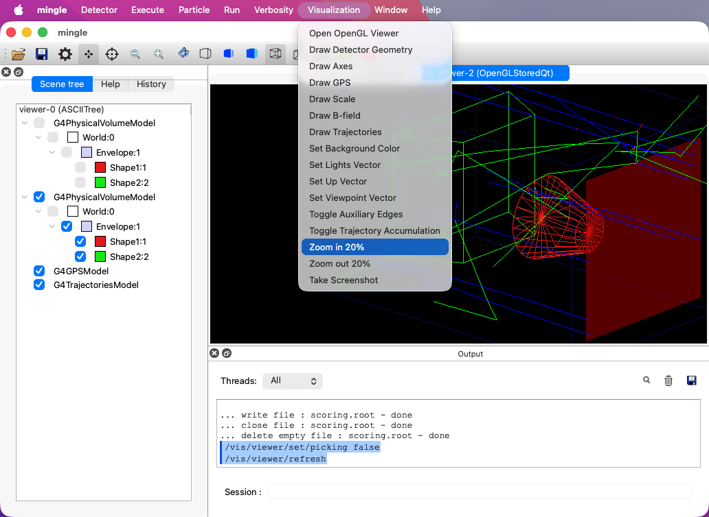

# Summary

The Geant4 toolkit [@geant4_2003; @geant4_2006; @geant4_2016] is the global standard for simulating particle transport through matter, yet its immense architectural flexibility introduces a steep learning curve for novice developers. This paper introduces **MinGLE** (Mini Geant4 Learning Example), a minimalist application template designed to bridge the gap between being a passive Geant4 end user and an active application developer. 

By leveraging modern factory classes, native text geometry syntax [@text_geometry], and the General Particle Source (GPS) [@gps_2004], MinGLE provides a complete, production-ready, and fully functional simulation kernel in under 70 lines of C++ code [@mingle_2026]. Its primary pedagogical innovation lies in an incremental, bottom-up development roadmap formalized through ten testable Git branches and tags [@progit_2014]. Each milestone introduces a single core Geant4 component (e.g., user interfaces, physics lists, scoring meshes, or magnetic fields), ensuring that every line of code is explicitly motivated by a functional requirement.

By default, running mingle will open a Geant4 GUI window (if that is enabled in the user's local Geant4 installation), providing a visual way to interact with the environment. A screenshot of the GUI on a Mac is shown in Figure 1.

{width=80%}

# Statement of Need

Traditional introductory examples provided by the Geant4 toolkit are frequently experiment-specific and characterized by substantial boilerplate code distributed across multiple source files [@geant4_B1]. This architectural overhead makes it difficult for beginners to discern the mandatory minimum code required to initialize and execute a simulation. While official documentation [@geant4_doc] provides excellent isolated C++ snippets, it lacks a cohesive, minimalist, and executable context showing how these components interact in a production environment. MinGLE directly fills this gap by offering a clean, modern starting point for custom research projects and a step-by-step educational resource that transforms passive documentation reading into an active, hands-on development experience.

# Key Features & Implementation

## Software Design

The architectural framework of MinGLE relies on a strict decoupling of configuration from runtime execution, a paradigm designed to lower cognitive overhead for developers. The implementation centers around three strategic decoupling mechanisms:

* **Structural Minimalism**: By compressing core operations into a single-file driver (`mingle.cc`), standard initialization boilerplate is isolated from structural application code.
* **Abstract Runtime Factories**: Utilizing `G4RunManagerFactory` and `G4PhysListFactory` shifts environmental and physical configurations out of hard-coded routines into automated factory patterns capable of reading runtime environment states.
* **Externalized Geant4 Text Geometry**: Geometry modeling is externalized to plain-text layout files (`detector.tg`) using `G4tgbVolumeMgr`. This replaces highly complex, multi-layered C++ volume definitions with declarative spatial configurations, mimicking production workflows without programmatic clutter.

# State of the Field

Existing Geant4 pedagogical assets broadly fall into two categories: standard toolkit examples, such as `B1` through `B5`; and comprehensive frameworks, such as GEARS [@gears_2025]. Toolkit examples excel at illustrating localized API calls but fail to provide an end-to-end modular development continuum; they present completed architectures that hide the chronological progression of building simulation kernels. Conversely, multi-featured frameworks abstract away fundamental C++ mechanics completely, positioning the developer purely as an application configuration operator. MinGLE bridges this structural chasm. It serves as an active educational pipeline, revealing the structural evolution of a simulation package incrementally through testable version control milestones.

# Research Impact Statement

MinGLE introduces a flexible, low-friction template designed to accelerate prototype simulation development across multi-disciplinary research frameworks, including low-background radiation physics, medical imaging development, and space science instrumentation. By eliminating multi-file boilerplate layout barriers, researchers can swiftly spin up sandboxed testing environments to characterize novel detector materials or configure complex spatial geometry distributions. Furthermore, its structured "branch-as-chapter" versioning pipeline offers a clear framework for onboarding undergraduate and graduate research assistants into collaborative physics workflows, minimizing structural training overhead and expediting active production contributions.

The real-world impact and active community engagement of the software are demonstrated through established national dissemination, containerized distribution, and peer training channels:

* **Educational Dissemination**: MinGLE serves as a core hands-on instruction tool for physics faculty members nationwide through lab immersions organized by the Association for Physics Laboratory Instruction ([ALPhA](https://www.advlab.org/immersions.html)), enabling instructors to cleanly integrate Geant4 environments into advanced undergraduate laboratories.
* **Multimedia Engagement**: The incremental mechanics and usage instructions of the template are fully animated and documented via a dedicated [YouTube playlist](https://www.youtube.com/playlist?list=PLw3G-vTgPrdCkTdisAL5UdUPazZdjqlpm), attracting thousands of public educational views from aspiring simulation developers.
* **Containerized Deployment**: To eliminate cross-platform compilation barriers, the template is fully bundled and distributed via a specialized [Docker Hub image](https://hub.docker.com/r/physino/geant4), recording thousands of independent downloads and demonstrating reliable utility within containerized research environments.

## Distributed Documentation ("Branch-as-Chapter")
Rather than utilizing a monolithic manual, MinGLE distributes its documentation across its version control system. The `main` branch acts as a "syllabus," while individual feature branches serve as "chapters" with specialized `README.md` and `run.mac` files. This isolates complexity and supports a "just-in-time" learning architecture.

## Advanced Developer Experience
MinGLE provides out-of-the-box support for the JSON Compilation Database standard (`compile_commands.json`) [@jsoncompilation] via CMake. By exporting compile commands, modern editors and language servers (such as VS Code [@vscode], Neovim, or CLion) can automatically resolve Geant4 header paths, providing intelligent auto-completion, error checking, and code navigation without manual configuration.

# Guided Development Roadmap

The project structures its incremental learning path across ten progressive milestones:

| Stage | Milestone | Branch | Tag | Core Focus |
| :--- | :---------- | :------- | :- | :---------------------------------------------------------- |
| 0 | User Interface | `ui` | `v0` | Interactive UI exploration and macro command tree navigation via TUI/GUI. |
| 1 | Batch Execution | `batch` | `v1` | Transitioning from interactive sessions to automated, non-interactive script execution. |
| 2 | Run Manager | `run` | `v2` | Kernel initialization and understanding multi-threaded execution lifecycles. |
| 3 | Physics List | `physics` | `v3` | Dynamically selecting validated, high-level physics processes using factories. |
| 4 | Detector Definition| `detector` | `v4` | Defining geometry and materials through human-readable parameters in external files. |
| 5 | Visual- ization | `vis` | `v5` | Implementing rendering systems to visualize complex 3D geometry and tracks. |
| 6 | Particle Generation| `gps` | `v6` | Controlling primary generator kinematics dynamically with General Particle Source [@gps_2004]. |
| 7 | Histogram Generation| `scorer` | `v7` | Collecting statistical distributions using command-line mesh scorers. |
| 8 | Ntuple Generation | `ntuple` | `v8` | Saving event-by-event raw data structures using standard analysis managers. |
| 9 | Magnetic Field | `field` | `v9` | Integrating field messengers to model particle deflection under uniform B-fields. |
# AI Usage Disclosure

During the preparation of this work, the author intensively utilized Google Gemini to assist with paper drafting, language polishing, structure refinement, and academic formatting. The core application logic, source code, and software architecture of MinGLE were developed entirely by the author without the use of artificial intelligence tools. Following the use of the AI service, the author thoroughly reviewed, edited, and verified all text contents, and takes full responsibility for the integrity and accuracy of the published manuscript.

# Acknowledgements

This work is supported by the NSF award OIA-2437416, PHY-2411825, and the Office of Research at the University of South Dakota. Computations supporting this project were performed on High Performance Computing systems at the University of South Dakota, funded by NSF award OAC-1626516.

# References